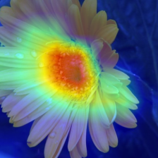
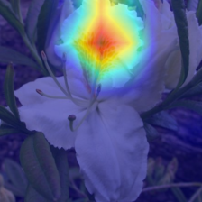

# Evaluation results

- **Top-1 test accuracy**: 0.9723
- **Top-5 test accuracy**: 0.9935

## Most confused class pairs

| Count | True class | Predicted as |
|---|---|---|
| 3 | snapdragon | sweet pea |
| 2 | sweet william | sweet pea |
| 2 | sweet william | garden phlox |
| 2 | canna lily | trumpet creeper |
| 1 | watercress | pink primrose |
| 1 | thorn apple | sweet pea |
| 1 | sword lily | thorn apple |
| 1 | sword lily | daffodil |
| 1 | sweet pea | toad lily |
| 1 | sweet pea | bougainvillea |
| 1 | rose | lenten rose |
| 1 | petunia | osteospermum |
| 1 | pelargonium | bolero deep blue |
| 1 | lenten rose | fritillary |
| 1 | japanese anemone | moon orchid |

## Full classification report

```
                           precision    recall  f1-score   support

            pink primrose       0.86      1.00      0.92         6
hard-leaved pocket orchid       1.00      1.00      1.00         9
         canterbury bells       0.86      1.00      0.92         6
                sweet pea       0.50      0.75      0.60         8
         english marigold       1.00      0.89      0.94         9
               tiger lily       1.00      1.00      1.00         6
              moon orchid       0.86      1.00      0.92         6
         bird of paradise       1.00      1.00      1.00        13
                monkshood       1.00      1.00      1.00         7
            globe thistle       1.00      1.00      1.00         6
               snapdragon       0.91      0.77      0.83        13
              colt's foot       1.00      1.00      1.00        13
              king protea       1.00      1.00      1.00         7
            spear thistle       1.00      1.00      1.00         7
              yellow iris       1.00      1.00      1.00         7
             globe-flower       1.00      1.00      1.00         6
        purple coneflower       1.00      1.00      1.00        13
            peruvian lily       0.87      1.00      0.93        13
           balloon flower       1.00      1.00      1.00         7
    giant white arum lily       1.00      1.00      1.00         8
                fire lily       1.00      1.00      1.00         6
        pincushion flower       1.00      1.00      1.00         9
               fritillary       0.93      1.00      0.97        14
               red ginger       1.00      1.00      1.00         6
           grape hyacinth       1.00      1.00      1.00         6
               corn poppy       1.00      0.83      0.91         6
 prince of wales feathers       1.00      1.00      1.00         6
         stemless gentian       1.00      1.00      1.00        10
                artichoke       1.00      1.00      1.00        12
            sweet william       0.90      0.69      0.78        13
                carnation       1.00      0.88      0.93         8
             garden phlox       0.71      0.83      0.77         6
         love in the mist       0.88      1.00      0.93         7
            mexican aster       1.00      1.00      1.00         6
         alpine sea holly       1.00      1.00      1.00         6
     ruby-lipped cattleya       1.00      1.00      1.00        11
              cape flower       1.00      1.00      1.00        16
         great masterwort       1.00      1.00      1.00         8
               siam tulip       1.00      1.00      1.00         6
              lenten rose       0.90      0.90      0.90        10
           barbeton daisy       1.00      1.00      1.00        19
                 daffodil       0.90      1.00      0.95         9
               sword lily       1.00      0.90      0.95        20
               poinsettia       1.00      1.00      1.00        14
         bolero deep blue       0.71      0.83      0.77         6
               wallflower       1.00      1.00      1.00        30
                 marigold       1.00      1.00      1.00        10
                buttercup       0.91      0.91      0.91        11
              oxeye daisy       1.00      1.00      1.00         7
         common dandelion       1.00      0.93      0.96        14
                  petunia       1.00      0.97      0.99        39
               wild pansy       1.00      1.00      1.00        13
                  primula       1.00      1.00      1.00        14
                sunflower       1.00      1.00      1.00         9
              pelargonium       1.00      0.91      0.95        11
       bishop of llandaff       1.00      1.00      1.00        17
                    gaura       1.00      1.00      1.00        10
                 geranium       1.00      1.00      1.00        17
            orange dahlia       1.00      1.00      1.00        10
       pink-yellow dahlia       1.00      1.00      1.00        17
         cautleya spicata       1.00      1.00      1.00         7
         japanese anemone       1.00      0.88      0.93         8
         black-eyed susan       1.00      1.00      1.00         8
               silverbush       0.89      1.00      0.94         8
        californian poppy       1.00      1.00      1.00        16
             osteospermum       0.90      1.00      0.95         9
            spring crocus       1.00      1.00      1.00         6
             bearded iris       1.00      1.00      1.00         8
               windflower       1.00      1.00      1.00         8
               tree poppy       1.00      1.00      1.00         9
                  gazania       1.00      1.00      1.00        12
                   azalea       1.00      0.93      0.97        15
               water lily       1.00      1.00      1.00        29
                     rose       1.00      0.96      0.98        26
              thorn apple       0.94      0.94      0.94        18
            morning glory       1.00      1.00      1.00        16
           passion flower       1.00      1.00      1.00        38
              lotus lotus       1.00      1.00      1.00        21
                toad lily       0.86      1.00      0.92         6
                anthurium       1.00      1.00      1.00        16
               frangipani       1.00      1.00      1.00        25
                 clematis       1.00      1.00      1.00        17
                 hibiscus       1.00      0.90      0.95        20
                columbine       1.00      1.00      1.00        13
              desert-rose       1.00      0.89      0.94         9
              tree mallow       1.00      1.00      1.00         8
                 magnolia       1.00      1.00      1.00         9
                 cyclamen       1.00      1.00      1.00        23
               watercress       1.00      0.96      0.98        28
               canna lily       1.00      0.85      0.92        13
              hippeastrum       0.92      1.00      0.96        12
                 bee balm       1.00      0.90      0.95        10
                ball moss       1.00      1.00      1.00         7
                 foxglove       1.00      0.96      0.98        25
            bougainvillea       0.95      1.00      0.97        19
                 camellia       0.93      0.93      0.93        14
                   mallow       0.77      1.00      0.87        10
          mexican petunia       1.00      1.00      1.00        13
                 bromelia       1.00      1.00      1.00         9
           blanket flower       1.00      1.00      1.00         7
          trumpet creeper       0.80      1.00      0.89         8
          blackberry lily       1.00      1.00      1.00         7

                 accuracy                           0.97      1229
                macro avg       0.97      0.97      0.97      1229
             weighted avg       0.98      0.97      0.97      1229
```


## Explainability (Grad-CAM)

Heatmaps show which regions of the image most influenced the prediction.

**correct** — true: `osteospermum`, predicted: `osteospermum`


**correct** — true: `barbeton daisy`, predicted: `barbeton daisy`



**correct** — true: `english marigold`, predicted: `english marigold`


**WRONG** — true: `thorn apple`, predicted: `sweet pea`


**WRONG** — true: `azalea`, predicted: `camellia`


